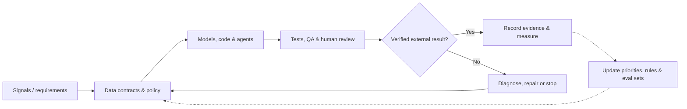
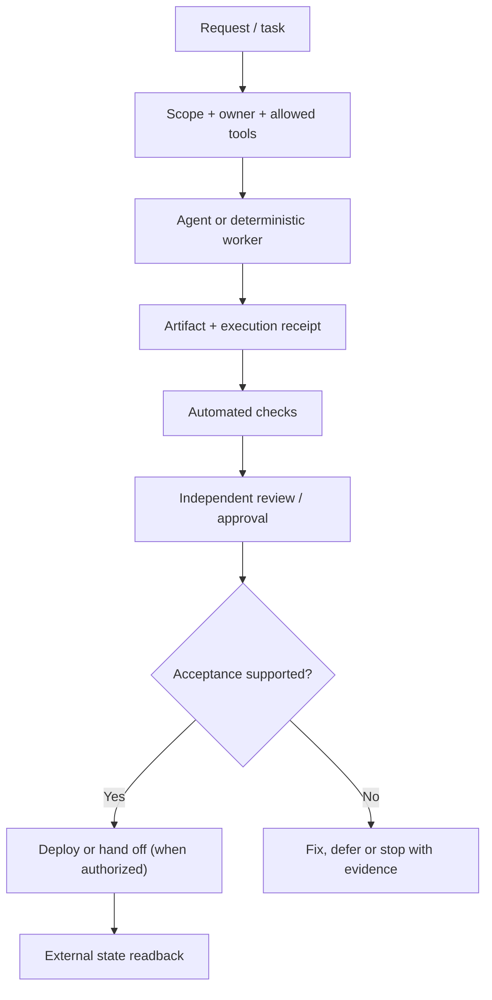

# Technical Overview: Applied AI, Data Science & Production Systems

**Kevin Fitzgerald · November 2026 portfolio snapshot**

This document describes engineering patterns across a personally maintained GitHub portfolio of **81 repositories: 69 original projects and 12 forks; 24 public and 57 private**. Counts are a repository inventory, **not** a claim of 81 deployed products, 81 original codebases, or independent customer adoption. Private code, infrastructure addresses, tokens, business data, and collaborator information are intentionally excluded.

## The core engineering problem

A model can produce plausible code, analysis, or media without producing an **operationally correct result**. My work addresses the gap between *generation* and *verified execution*: define a contract, build the system, validate the artifact, verify the external state, and preserve evidence for the next decision.

**Important:** This is the common operating model across projects, **not** a claim that every arrow is fully automated or deployed as a single platform.

## Flagship implementation areas

| System | Engineering emphasis | Evidence and current boundary |
| --- | --- | --- |
| **Revenue OS** | Python/SQL opportunity scoring, lifecycle records, agent-supported research, product/campaign decision workflows, Supabase/Postgres and operator dashboards | July 2026 internal audit captured **8,426 opportunity records**, 124 lifecycle candidates, 17 product records and 69 approval records. These are distinct record types, not paying users or revenue. The entire signal-to-revenue loop remains under integration and verification. |
| **Enterprise Dashboard** | Next.js/TypeScript control plane, persistent state, review queues, approvals, service health and operating evidence | A multi-section internal operator interface exists. A dashboard view is **not** proof that connected workers, providers or commerce workflows succeeded. |
| **Daily Engine & Story Foundry** | Multi-brand **social content production**: research, editorial policy, concept, media, QA, approvals, scheduling and publication readback | Generation and gating components exist; media generation and provider publication reliability remain active work. **Story Foundry is social automation**, not Campaign Foundry. |
| **Campaign Foundry** | Campaign packaging: positioning, audience, assets, channel variants, approval gates and validated handoffs | Schema/contract-led components exist; campaign creation and successful distribution are separately verified. |
| **Enterprise Conductor** | Cross-agent task ownership, evidence classification, immutable-style receipts, validation and release claims | An implementation and documented trust practices exist. A recorded receipt is not automatically independent acceptance or production deployment. |
| **Git Workflow Harness** | Scoped staging, preflight, validation, secret checks, review, commit/push verification and receipts | Repository contains a CLI/policy/hooks/tests; enforcement coverage is being expanded. Local hooks alone are not a substitute for server-side controls. |
| **VPS Control Plane** | Ansible desired state, service definitions, systemd timers, functional canaries and bounded remediation | Repository documents deterministic convergence and failure detection. Actual running state requires a fresh VPS check. |
| **Deck Studio / Digital Product Factory** | Structured generative workflows, exact-count checks, reference controls, image QA, and branded PDF assembly | The decks and workflows are substantial implementation efforts; final product integration and all acceptance gates are not implied complete. |
| **Sentient Venture Engine** | Research-stage opportunity hypothesis generation, causal-analysis code, reinforcement-learning experiments and evaluation | Experimental algorithms and tooling are distinct from a validated online policy improving real business results. |
| **Mystic Arcana, BirthdayGen, EDM Shuffle, MindVault** | Next.js/React, TypeScript, Python, Supabase/PostgreSQL, commerce, personalization and AI-assisted product flows | Product features have different states: built, previewed, deployed, and externally accepted are not synonyms. |

## Three reusable technical architectures

### 1. Evidence-governed agent workflow

Design decisions: idempotency for retried work; explicit state transitions; separate implementer/reviewer responsibilities; one write owner per area; a distinction between **created**, **tested**, **committed**, **deployed**, and **live**.

### 2. Contract-first content and campaign production

1. Define inputs, required artifacts, schemas, brand rules and publication constraints.
2. Gather cited or structured signals; distinguish factual assertions from creative interpretation.
3. Draft story, copy and media specifications; evaluate whether text, image and motion express the same concept.
4. Validate file existence, dimensions, counts, policy compliance, metadata and revision hashes.
5. Gate consequential publishing on approved content; approval of one version does not approve a later mutation.
6. Request distribution and independently read the provider's result where supported.
7. Capture outcomes for tomorrow's prioritization without rewriting yesterday's evidence.

This pattern generalizes to document factories, product catalogs, content pipelines, AI evaluations and other staged production workflows. It is also deliberately **fail-closed**: missing media or an unverified post does not count as successful publication.

### 3. Data science into an operator decision

My earlier enterprise work supplies the quantitative foundation for these systems:

- **ADP:** Databricks, Python and SQL data pipelines; LSTM-based NLP models for NPS and email feedback; customer-experience analysis used in business/product discussions.
- **Arbitration Forums:** predictive modeling and a product comprising **500+ insurer-specific KPI insight models**, including direct filing and liability/dispute analytics.
- **IBM/Kenexa:** a **$5M+ external-client analytics portfolio**; survey design and statistical linkage of workforce behavior to business outcomes.
- **Cox Communications:** customer and campaign analytics, regression/driver analysis, forecasting and budget-related decisions.

The consistent method is **define the decision → choose the measurement grain → evaluate the model and uncertainty → connect analysis to an actual stakeholder workflow**.

## Adaptive learning: implemented patterns vs. future capability

| Mechanism | What it does | What it does **not** establish |
| --- | --- | --- |
| Test and evaluation feedback | Regression cases and failed checks inform changes to code, policies and fixtures | Automatic neural-network retraining |
| Deck-generation learning records | Accepted/rejected visual attempts inform reference selections, QA constraints and subsequent runs | Unsupervised convergence to perfect art |
| Outcome and state readback | Provider responses, job states and analytics can inform future choices | Verified revenue attribution for every workflow |
| Causal-analysis and RL prototypes | Explore adaptive threshold and hypothesis-evaluation strategies | Proven online uplift or a fully deployed learning policy |
| Postmortem-to-rule conversion | Repeated incidents become deterministic checks, acceptance criteria and runbooks | Elimination of all production incidents |

The architecture favors **observable, reversible, reproducible updates** over unverifiable promises of autonomous improvement.

## Engineering invariants

- **Evidence before status:** a completed API call, a merged PR and a real user outcome are different facts.
- **Contracts before orchestration:** schemas and acceptance criteria are executable interfaces.
- **Deterministic checks before LLM judgment:** code can enforce many structural and safety conditions more reliably.
- **One owner per write scope:** prevents race conditions and agent collisions.
- **Secrets never enter public artifacts:** document interfaces, patterns and sanitized examples only.
- **Versioned handoffs:** preserve context between sessions, models and human operators.
- **Failure is a typed result:** capture the reason, retry only when appropriate, and avoid indefinite loops.

## What I want to publish next

Sanitized examples of a contract-first generator, an evidence/receipt validator, a deterministic canary, and an agent evaluation harness—with fixtures, test commands and observable pass/fail outcomes. Those would turn private operating patterns into reusable public reference implementations.

**See also:** [Journey, Lessons & Reusable Playbooks](JOURNEY-AND-LESSONS.md) · [GitHub profile](../README.md)
